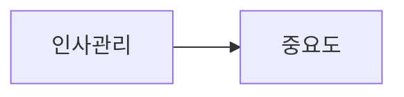

# 2026-10-26 MS Word 내보내기의 Mermaid 이미지 보존

- 변경 ID: `MDPRO-20261026-DOCX-MERMAID`
- 원본: `C:\CusorApps\Webdav_md\webdav-md` / 대상: `C:\CusorApps\md-viewerVscode\md_viewer`
- 작성·확인: 2026-10-26 (Asia/Seoul), 원본 로컬 미커밋 변경
- 상태: WebDAV 구현·자동 검사·격리 브라우저 검증 완료. 상대 앱은 읽기 비교만 수행. 상대 이식·Tauri 준비·네이티브 빌드·설치 앱 검증·배포는 미실행.

## 요청과 완료 기준

내보내기 선택 창의 **MS Word (.docx)**에서 Mermaid 블록마다 렌더링된 이미지와 재사용 가능한 원본 코드를 함께 포함한다. 원본 Markdown은 변경하지 않는다. 기존 코드에도 PNG 내보내기가 있었지만, HTML 라벨이 있는 문서를 HTML 문서로 오인하거나 PNG 생성 실패를 무시해 다이어그램이 빠질 수 있었다. 빈 HTML 문단 때문에 PNG의 노드 글자가 사라지는 문제도 브라우저 결과 검토에서 재현했다.

## 실제 구현

| 파일·함수 | 변경과 이유 |
| --- | --- |
| `mdpro/js/app.js`: `createCurrentDocumentDocxBlob()` | 기존 `withPreparedMermaidExportViewer()`로 편집 모드의 숨겨진 보기를 화면 밖에서 렌더링한다. 공유 `MermaidTRT.exportWrapperImage(wrapper, 'png')`를 문서 순서대로 호출해 큰 Canvas의 동시 할당을 줄인다. PNG 결과를 확인하고 실패 도표 번호를 알린다. SVG fallback 대신 준비 이미지 수를 확인하고 `requireMermaidImages: true`를 전달한다. |
| `mdpro/js/extendFiles/docx-export.js`: `createBlob()` | 코드 fence가 있으면 HTML 태그만으로 HTML 문서 경로를 선택하지 않는다. Mermaid 라벨의 `<div>` 등도 원본 코드로 유지된다. 필수 Mermaid 이미지의 자산 변환 오류는 다운로드 전에 전파한다. 일반 이미지의 기존 오류 처리 방식은 유지한다. |
| 같은 파일: `markdownToDocxItems()` | 이미지가 없는 필수 Mermaid 블록은 실패 처리한다. 원본 문자열로 이미지 대응 후 이미지와 코드를 순서대로 출력한다. backtick/tilde fence의 종류·길이를 기억하고 같은 종류의 충분히 긴 종료 fence만 닫는다. |
| `mdpro/js/mermaid/mermaid_render.js`: `replaceMermaidHtmlLabelsForPng()` | 텍스트 없는 `<p>`들을 제외하고, 유효 문단이 없으면 `foreignObject` 전체 텍스트를 사용한다. `<div>인사관리</div>` 양옆에 생기는 빈 문단 때문에 글자가 없어지는 문제를 수정했다. 기존 공유 PNG 경로이므로 보기의 PNG 삽입 및 PDF에도 영향을 준다. |
| 캐시 | `app.js`의 DOCX 자원 버전 `20261026-mermaid-images-1`, `index.html`의 app Mermaid 키 `20261026-docx-images-1` 및 renderer 버전 `20261026-docx-labels-1`, PWA 캐시 `20261026-docx-mermaid-images-1`로 갱신했다. |

핵심 연결:

```js
mermaidImages.push({ src: rendered.dataUrl, mermaidSource: originalSource, /* dimensions */ });
// createBlob payload
requireMermaidImages: true
```

의존성 추가 없음. 실제 렌더러의 고해상도 PNG 설정과 비율을 유지한다. 인쇄/PDF 계약과 기존 Mermaid 이미지 기술 가이드를 참조했으며 이번 작업은 인쇄/PDF 계약 전체 준수 검증을 의미하지 않는다.

## 상대 앱 대응표와 이식 순서

2026-10-26 대상의 실제 대응 파일을 읽어 비교했다.

| 원본 | 대상 | 확인된 차이·선행 조건 |
| --- | --- | --- |
| `mdpro/js/app.js`: `createCurrentDocumentDocxBlob()` | `js/app.js`: 같은 함수 | 대상도 공유 PNG 변환기를 호출하며 PNG catch는 이미 오류를 던진다. 그러나 Promise.all 동시 처리 및 SVG fallback이 있고 필수 이미지 옵션이 없다. 기존 대상 오류 처리와 저장 브리지를 보존하며 필요한 차이만 이식한다. |
| `mdpro/js/extendFiles/docx-export.js` | `js/extendFiles/docx-export.js` | 대상의 HTML 문서 판정에도 fence 제외가 없고, fence 처리가 backtick 전용이다. 필수 이미지 검사·문서 경로 판정·fence 처리를 함께 이식한다. |
| `mdpro/js/mermaid/mermaid_render.js` | `js/mermaid/mermaid_render.js` | 대상도 `paragraphs.length ? Array.from(paragraphs) : [label]` 방식이다. 빈 문단 fallback 수정이 필요하다. |

대상 `index.html`·PWA·패키징 경로는 별도로 확인한 후 해당 캐시만 갱신한다. 전체 app.js/renderer 파일을 복사하지 않는다. 대상 문서 사본은 아직 작성하지 않았다.

## 회귀 예제와 검증



- 위 블록과 두 번째 한글 도표를 본문 설명 뒤에 배치한다. DOCX 안에 PNG 두 개와 코드 두 개가 순서대로 있어야 한다.
- tilde fence와 긴 backtick 안의 짧은 fence, 이미지 목록 순서가 뒤집힌 경우, 필수 이미지 누락 및 잘못된 데이터 URL을 검사한다.
- `node --test tests/docxMermaidExport.test.mjs tests/mermaidViewImageInsert.test.mjs tests/pdfMermaidExport.test.mjs`: 최종 16/16 통과.
- `node --check` app.js, docx-export.js, mermaid_render.js 및 `git diff --check`: 통과.
- `npm run build`: 최종 통과. 기존 500kB 초과 chunk 경고 있음.
- 추가로 실행한 `tests/mermaidImageExport.test.mjs`는 4/5 통과, 편집기 cache key 검사 1건 실패. 테스트 기대값은 `20261020-wysiwyg-export-1`, 기존 HEAD의 `js/mermaid/mermaid-editor/index.html` 값은 `20261021-ai-inline-21`이다. 이번에 수정하지 않은 기존 불일치이며 임의로 이전 버전으로 되돌리지 않았다.
- `tests/mermaidViewImageInsert.test.mjs`의 renderer cache key 기대값은 이번 버전 변경에 맞춰 갱신했다. 갱신 전 실패와 구분해 최종 통과 결과를 기록한다.
- `tests/docxMermaidExport.browser.cjs`: Chrome 145에서 실제 Mermaid 엔진 → 공유 PNG → 실제 JSZip DOCX 생성 통과. app.js의 실제 준비/내보내기 함수와 MarkdownIt를 사용하고 편집기·선택 메뉴는 격리 fixture로 대체했다. 한글 라벨의 PNG 변환 전 SVG tspan, 두 이미지의 PNG signature·크기, `word/document.xml` drawing 두 개와 원본 코드를 확인했다. 강제 PNG 실패 시 오류 전파, 숨김 스타일 복구, Markdown 보존도 통과했다.
- 최초 샌드박스 안 Chrome 실행은 종료 코드 3221225506으로 실패했고, 승인된 샌드박스 외 실행에서 성공했다.
- 로컬 증거: `C:\CusorApps\Webdav_md\check\docx-mermaid-proof\mermaid-export.docx`, 같은 폴더의 `image1.png`, `image2.png`. 첫 PNG의 한글 두 라벨을 직접 이미지 검토해 확인했다.
- 전체 앱 메뉴 클릭, 실제 MS Word에서 새 DOCX 열기·페이지 배치, 사용자 원문 문서, 배포 캐시·설치 앱은 미검증. 첨부 스크린샷만으로 원문 전체 Mermaid 코드를 복원하지 않았다.

브라우저 재실행은 `NODE_PATH`에 Playwright 설치 경로, `PV_MERMAID_ENGINE`에 앱과 같은 Mermaid bundle, 필요 시 `PV_TEST_BROWSER`에 Chrome 실행 파일을 지정한 후 `node tests/docxMermaidExport.browser.cjs`를 실행한다. 기본 증거 출력은 작업공간 `check/docx-mermaid-proof/`다.

## Tauri 반영 계획

빌드 대기 ID `MDPRO-20261026-DOCX-MERMAID`. 대상 웹 이식 후 DOCX·공유 PNG 회귀 및 Word 열기 검증을 수행한다. Tauri 요청 시 대상 `Docs/mdpro-development/TAURI_BUILD.md`를 따라 프런트엔드 준비, `Tauri/dist`의 app/DOCX/renderer/cache 자산 포함, 네이티브 빌드 및 설치 앱 내보내기 검증을 별도로 기록한다. 이번에는 실행하지 않았다.

## 다른 앱에서 다시 실행할 명령

```text
C:\CusorApps\md-viewerVscode\md_viewer에서 작업해줘. AGENTS.md와 WebDAV의
C:\CusorApps\Webdav_md\webdav-md\docs\mdpro-development\changes\2026-10-26-docx-mermaid-images.md,
대상의 Mermaid 이미지 기술 가이드와 개발 기록 절차를 읽고 MS Word 내보내기의
Mermaid PNG·원본 코드 포함을 보완해줘. 대상의 기존 오류 처리·브리지는 유지하고,
HTML 라벨 문서 판정, 빈 p 라벨, fence 종류·길이, 필수 이미지 누락 실패 검사를
함께 이식해줘. 전체 파일을 덮어쓰지 말고 회귀 예제·실제 DOCX·Word 열기를 검증해줘.
기술문서·목록·Tauri 대기 상태도 갱신해줘. 이번 명령에는 Tauri 빌드·배포는 포함하지 않아.
미검증 항목은 구분해서 보고해줘.
```
